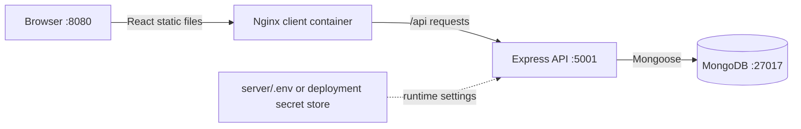

# Fixly — Home Service Booking Platform

A MERN application based on the screens from your project report. The home page includes a blue navigation bar, a “Trusted Home Services” hero, Customer/Provider/Admin login portal cards, service photo cards, and a service booking form. The Express API uses MongoDB and Mongoose to save accounts, services, and bookings.

## Requirements

- Node.js 18 or newer and npm
- MongoDB running locally, or a MongoDB Atlas connection URI

## Environment variables and GitHub security

The API loads `server/.env` at startup through `import 'dotenv/config'` in `server/src/index.js`. The file is for local secrets and is ignored by Git. Start from the committed, placeholder-only [`server/.env.example`](server/.env.example): copy it to `server/.env`, then set a private MongoDB URI, a long random `JWT_SECRET`, and a unique `ADMIN_PASSWORD`. Do not commit, paste into issues, or include real values in screenshots. The example file is safe to commit and documents the settings the API expects:

| Variable | Purpose |
| --- | --- |
| `PORT` | Express API port (defaults to 5001) |
| `MONGODB_URI` | MongoDB connection string |
| `JWT_SECRET` | Signs and verifies login tokens |
| `JWT_EXPIRES_IN` | Token lifetime (defaults to `7d`) |
| `CLIENT_URL` | Allowed deployed browser origin for CORS |
| `ADMIN_NAME`, `ADMIN_EMAIL`, `ADMIN_PASSWORD` | Initial administrator account, created if absent |

The React client only reads `VITE_API_URL`. Vite embeds `VITE_*` values in browser assets, so never put credentials, database URLs, or private API keys in a `VITE_*` variable. The current app does not use Gemini, OpenAI, or email credentials; add such keys only on the server if those features are introduced.

Before pushing, review `git status --short` and `git check-ignore -v server/.env`. If an environment file was ever committed, remove it from the Git index (for example, `git rm --cached server/.env`), commit that removal, and rotate every credential it contained. Removing a file from the latest commit does not erase it from Git history. Never force-push or rewrite shared history without coordinating with repository collaborators.

For a new GitHub repository, create an empty repository, then from this project root run `git init` (if needed), `git add .`, `git status --short`, `git commit -m "Initial commit"`, `git branch -M main`, `git remote add origin <your-repository-url>`, and `git push -u origin main`. Inspect the staged file list before committing; never use `git add -f` on environment files. If this folder is already a Git repository, keep its existing remote and branch and use `git add`, `git commit`, and `git push` after reviewing the staged changes.

## Docker and Jenkins (DevOps submission)

The repository includes `server/Dockerfile`, `client/Dockerfile`, `client/nginx.conf`, `docker-compose.yml`, and `Jenkinsfile`. Compose runs MongoDB, the Express API, and the built React site. Create `server/.env` as described above, then run `docker compose up --build`; open `http://localhost:8080` (the API is also available at `http://localhost:5001/api/health`). The Compose file overrides `MONGODB_URI` inside the API container to use the `mongo` service. MongoDB data persists in the named `mongo_data` volume.

Jenkins should check out this repository on an agent with Node.js/npm and Docker access. The pipeline installs from lockfiles, builds the client, and builds both container images. It does not publish images or deploy them: configure registry credentials and a deployment target in Jenkins before adding those steps, and store secrets in Jenkins Credentials rather than in the Jenkinsfile or repository.

### Architecture



The browser talks to Nginx on port 8080. Nginx serves the Vite build and forwards `/api` requests to Express. The API reads its runtime configuration from environment variables and connects to MongoDB. In production, inject secrets through the hosting platform's secret manager; do not bake them into Docker images.

## Run the project

1. Extract the ZIP and open the `fixly-home-service-platform` folder in VS Code.
2. In a terminal at the project root, copy `server/.env.example` to `server/.env`.
3. Keep or update the MongoDB URL. To use your local MongoDB database shown in Compass:

   ```env
   MONGODB_URI=mongodb://127.0.0.1:27017/HomeServiceDB
   ```

   Replace `JWT_SECRET` with a long random value. Set a private `ADMIN_EMAIL` and `ADMIN_PASSWORD`; the API creates that admin account the first time it connects.
4. Make sure MongoDB is running. Then install packages:

   ```bash
   npm install
   npm install --prefix server
   npm install --prefix client
   ```

5. Start the API and client in two separate terminals from the project root. This also works if Windows cannot start the combined command:

   **Terminal 1:**
   ```bash
   npm run dev --prefix server
   ```

   **Terminal 2:**
   ```bash
   npm run dev --prefix client
   ```

6. Visit the Vite `Local` address (usually `http://localhost:5173`; it may use 5174 if 5173 is occupied). The API health page is `http://localhost:5001/api/health`.

## Try the roles

- Register a **Customer** account, choose a service, and submit a booking. You must be signed in as a customer to save a booking.
- Register a **Provider** account, then sign in as your configured **Admin** and approve the provider from the admin dashboard. Approved providers can accept available bookings and update their work status.
- Sign in from **Admin Login** using `ADMIN_EMAIL` and `ADMIN_PASSWORD` in `server/.env`. Admin accounts are created from these settings, not from the public registration form. After login the app opens the dashboard, where the admin can approve providers, accept/update orders, delete orders, and manage services.

The login portal buttons are role-specific. Admin registration is disabled; create the first admin via the environment settings.

## MongoDB collections

Mongoose stores data in the standard `users`, `services`, and `bookings` collections in the database specified by `MONGODB_URI`. These match the collection names visible in your Compass screenshot. On first startup, the API adds six example services only if `services` is empty. It creates an admin only if that admin email does not already exist. Existing collections are reused; back up existing data before trying writes if those documents use another schema.

Bookings record the customer, selected service, phone number, address, appointment date and time, problem description, price, provider assignment, and status history. Statuses are `requested`, `accepted`, `in_progress`, `completed`, and `cancelled`.

## API routes

- `POST /api/auth/register`, `POST /api/auth/login`, `GET /api/auth/me`
- `GET /api/services`; admin `POST /api/services`, `PATCH /api/services/:id`, `DELETE /api/services/:id` (deactivates a service)
- Customer `POST /api/bookings`; authenticated `GET /api/bookings`; provider/admin `PATCH /api/bookings/:id/status`; admin `DELETE /api/bookings/:id`
- Admin `GET /api/providers`, `PATCH /api/providers/:id/approval`, `GET /api/admin/summary`
- `GET /api/health`

## Production build

```bash
npm run build
```

The built client is created in `client/dist`. Set `CLIENT_URL`, `MONGODB_URI`, `JWT_SECRET`, and `VITE_API_URL` to deployment values before publishing.
